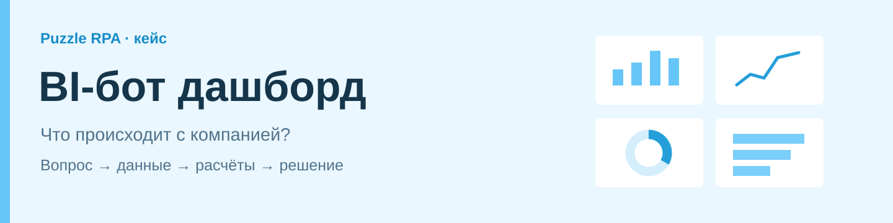
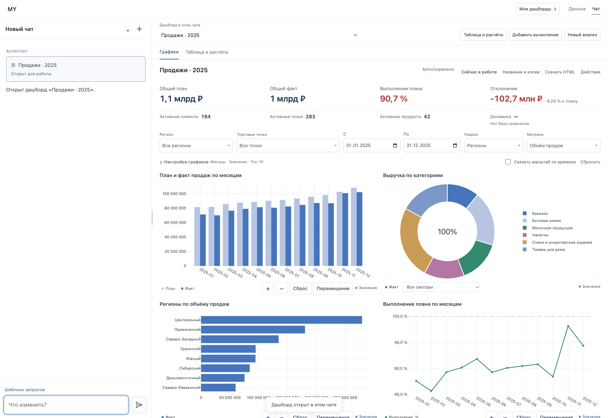
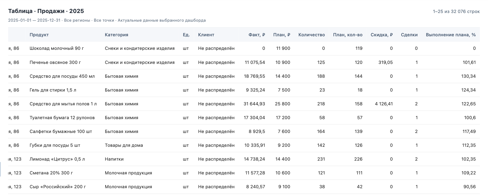
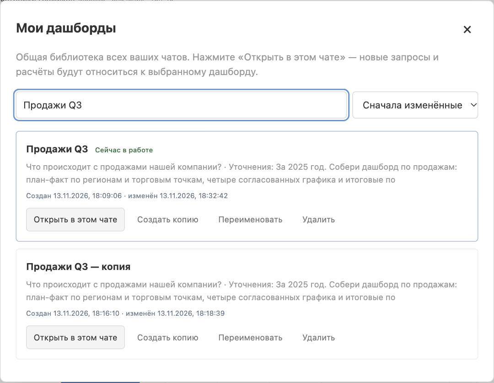

<p align="center"></p>

# BI-бот дашборд

Аналитический ассистент по кейсу **Puzzle RPA**. Пользователь задаёт вопрос обычными словами, проверяет исходную таблицу и получает интерактивный дашборд. Затем уточняет выборку, добавляет расчёты и сохраняет результат для следующей встречи.

На компьютере **чат слева, рабочая область справа**. Таблица и графики относятся к выбранному дашборду; границу панелей можно двигать мышью. На узком экране доступны вкладки переписки и дашборда.

**[Презентация: история Свята](docs/presentation/BI-бот%20дашборд%20—%20история%20Свята.pptx)** · [Сценарий демонстрации и покрытие ТЗ](docs/presentation/README.md) · [Docker](docs/docker.md) · [Техническое описание](docs/technical-guide.md)

## Запуск

Нужен работающий Docker с Compose. Из корня проекта:

```sh
./scripts/docker_start.sh
```

Откройте **http://127.0.0.1:8080**. Скрипт собирает приложение, запускает PostgreSQL, импортирует восемь таблиц тестового источника и поднимает отдельный viewer опубликованных снимков на 8082. При первом запуске нужны сеть и авторизация Codex с доступом к модели. Существующий локальный вход переносится в приватный том; при его отсутствии предлагается вход по коду устройства.

Пароли генерируются автоматически в исключённом из Git `.env.docker`. Сохранённые дашборды, данные и авторизация остаются в Docker-томах после обычного `docker compose down`. Docker использует отдельное хранилище; рабочая локальная база пользователя автоматически в него не переносится. Если 8080 занят, измените `BI_PORT` в `.env.docker`.

Подробные настройки, резервные копии и ручные команды — в [инструкции Docker](docs/docker.md). Без Docker можно запустить `./scripts/start_local.sh`; требования описаны в [техническом руководстве](docs/technical-guide.md#запуск-без-docker).

## Свят хочет понять, что происходит с компанией

Перед обсуждением продаж Свят хочет узнать, выполняется ли план, где возникает отставание и какие торговые точки стоит изучить подробнее. Он начинает с вопроса:

> Что происходит с продажами нашей компании?

Ассистент уточняет период. Свят отвечает: «За 2025 год» и просит стандартный дашборд. Переписка, единая таблица и дальнейшие правки остаются в одном рабочем контексте.



### Полный маршрут демонстрации

| Шаг | Действие Свята | Что он получает |
| --- | --- | --- |
| 1 | Задаёт вопрос о продажах и уточняет период | Контекст задачи, данные из PostgreSQL и стандартный дашборд |
| 2 | Просит показать единую таблицу | Таблицу с периодом, разрезами, планом и фактом в правой панели |
| 3 | Смотрит четыре графика и KPI | План-факт по времени, структуру, рейтинг и выполнение плана |
| 4 | Находит Центральный регион в фильтре | Общий пересчёт графиков, KPI и краткого итога |
| 5 | Приближает участок, наводит курсор, переключает серии | Точные значения, нативный зум и управляемую легенду |
| 6 | Меняет разрез с регионов на точки | Сравнение точек; можно выбрать несколько одновременно |
| 7 | «Добавь колонку с процентом выполнения плана» | Вычисляемую колонку `fact / plan * 100` в единой таблице |
| 8 | «Перестрой третий график — отсортируй по проценту выполнения» | Рейтинг по выбранной метрике с видимым ограничением ТОП-N |
| 9 | Выбирает июль — сентябрь и сохраняет «Продажи Q3» | Именованный результат с таблицей, формулами, фильтрами и конфигурацией |
| 10 | Возвращается после перезапуска, находит и открывает дашборд | Восстановленное состояние вместо повторной сборки анализа |
| 11 | Продолжает работу и создаёт копию | Отдельный вариант для эксперимента, исходный анализ сохраняется |

Эти шаги соответствуют обязательному демонстрационному сценарию приложенного ТЗ. В [презентации](docs/presentation/BI-бот%20дашборд%20—%20история%20Свята.pptx) показан один герой — Свят — и реальные экраны отдельного тестового экземпляра MY. Числа относятся к тестовой базе кейса Puzzle RPA, а не к действующей компании Свята.

### Проверка цифр и вычисления



Расчёты выполняются **в приложении после выгрузки**, а не аналитическим SQL. Процент выполнения в итогах — отношение суммарного факта к суммарному плану. При объединении продаж и плана учитывается их разная детализация: суммы не должны размножаться.

Можно добавить, изменить, удалить или отменить формулу; доступны доли, динамика к предыдущему периоду, накопительный итог и групповые показатели. Нулевой знаменатель, отсутствие плана и базы сравнения обрабатываются явно. Для обычной смены фильтра или масштаба модель повторно не вызывается.

### Живой анализ

- **Фильтры:** поиск внутри списка, множественный выбор, каскад «регион → точки», даты. Выбор действует на все графики и KPI карточки.
- **Переключатели:** регионы / точки / продукты; объём / скидки / сделки / выполнение; месяц / квартал / год; значения / доли от общего объёма / динамика.
- **Интерактивность:** колесо мыши и выделение области, точные подсказки, переключение серий, сброс и перемещение. В кольцевой диаграмме — выбор сектора с суммой и долей. Временной зум можно связать между графиками.
- **KPI и резюме:** план, факт, выполнение, отклонение, активные клиенты / точки / продукты и динамика. Под дашбордом — краткий итог по текущим фильтрам.
- **Независимые карточки:** предыдущий дашборд можно открыть и редактировать после построения следующего. Чаты имеют собственную переписку, а библиотека дашбордов общая для владельца.

### Возврат к результату



Изменения сохраняются автоматически. В общей библиотеке доступны поиск по названию и исходному запросу, сортировка, открытие, переименование, копирование и удаление. Восстанавливаются таблица и вычисления, графики, фильтры, переключатели и KPI. Обновление данных из БД выполняется отдельным действием.

Можно работать и командами: «Покажи мои дашборды», «Открой дашборд “Продажи Q3”», «Сделай копию дашборда». Все восемь команд библиотеки проверены ранее через настоящий ИИ — [протокол](docs/verification.md).

Дополнительно реализованы история версий с восстановлением, черновик сообщения, шаблоны запросов, экспорт дашборда в **HTML / PNG** и таблицы с вычислениями в **CSV / Excel**. HTML — автономный снимок с локальной интерактивностью; он не обновляет исходную БД. Публикация даёт ссылку на снимок для просмотра без чата и редактора; публикацию можно обновить или отозвать. Временная внешняя ссылка с Mac работает, пока запущен туннель.

## Что входит в решение

| Слой | Реализация |
| --- | --- |
| Интерфейс MY | Белая рабочая среда: чаты, правая панель графиков / таблицы, адаптивная раскладка |
| Агент | Codex, по умолчанию `gpt-6.1-terra / medium`; цикл вызовов проверяемых инструментов и контекст уточнений |
| Данные | PostgreSQL; учётная запись только для чтения, ограниченные запросы |
| Вычисления | pandas и ограниченный язык формул; повторное использование загруженной таблицы |
| Графики | Plotly для интерактивности; Seaborn / Matplotlib для палитр и статического экспорта |
| Хранение | SQLite: переписка, независимые карточки, библиотека, версии, черновики и публикации |
| Запуск | Docker Compose: приложение, PostgreSQL, однократный импорт и отдельный viewer |

Исходное ТЗ использовано для бизнес-сценариев. Текущая реализация следует последующим решениям по проекту: самостоятельный MY и интерактивность Plotly. Модель управляет структурированными инструментами; её произвольный Python, SQL или HTML не исполняется.

## Проверки и документация

Релиз Docker от **12 ноября 2026** проверен 370 локальными pytest с PostgreSQL, сборкой в GitHub Actions и настоящим запросом к модели внутри ARM64-контейнера. В CI модель заменена явно выбранным адаптером `demo`, а PostgreSQL, импорт, дашборд, таблица и HTML-экспорт настоящие. [Протокол проверок](docs/verification.md) различает эти режимы.

При подготовке презентации **13 ноября** отдельно пройден пользовательский маршрут на PostgreSQL с настоящей моделью: уточнение периода, таблица, вычисление, перестройка графика, сохранение, физический перезапуск, повторное открытие, копия в другом чате, версии и экспорт. Это демонстрационный прогон; полный набор pytest ради изменений документации повторно не запускался.

```sh
RPA_TEST_POSTGRES=1 uv run pytest -q
uv run ruff check .
uv run ruff format --check .
```

- [Сценарий выступления, покрытие ТЗ и сборка презентации](docs/presentation/README.md)
- [Архитектура и работа с данными](docs/architecture.md)
- [Docker, настройки и резервные копии](docs/docker.md)
- [Полное техническое описание и локальный запуск](docs/technical-guide.md)
- [Проверки пользовательских сценариев](docs/verification.md)
